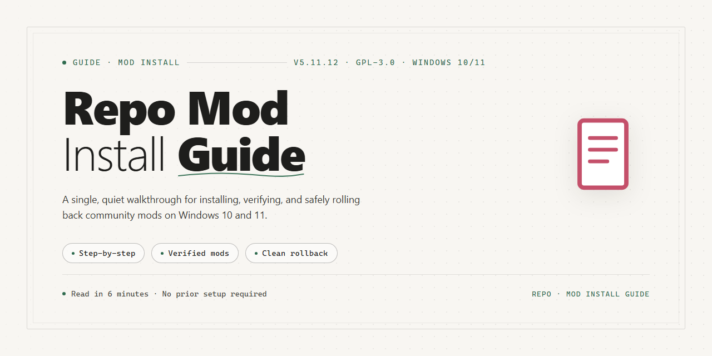

# 🔧 REPO Mod Install Guide: Thunderstore & Mod Managers Explained

### 🖥️ PowerShell Setup

   

---

Installing mods for R.E.P.O. is straightforward once you understand where the game lives and which tool handles the files, but the number of available methods makes the first attempt more confusing than it needs be. This guide walks through the realistic options — a Thunderstore mod manager, Vortex, and a manual BepInEx setup — and explains the trade-offs between them rather than pretending one answer fits every player. It also covers the co-op dimension that single-player guides tend skip: which mods only the host needs, which must be on every client, and share a working profile with your group. The steps assume a Windows install on Steam, note where Linux and Proton behave differently, and include the verification and troubleshooting checks worth knowing before something breaks mid-lobby.

## ✅ Requirements

- **OS:** Windows 10 / 11
- **Shell:** PowerShell 5.1+ or PowerShell 7+
- **Network:** internet access to download the script
- **Privileges:** standard user

## Requirements

Before you touch a single mod, get the basics place. None of the steps below are optional, and skipping one is the usual reason a first install goes wrong.

- **A PC running Windows 10 or later, or Linux.** The methods this guide assume a standard Steam install. Linux users will be running the game through Proton, and a couple of extra settings apply there.
- **R.E.P.O. on Steam.** Install and launch the game at least once before modding. That first launch generates the config files, save data, and folder structure that BepInEx and mod managers expect find. Installers that run against a game that has never been opened tend fail silently or place files the wrong spot.
- **Around 500 MB of free disk space.** A typical mod list stays well under this, but BepInEx, a mod manager, and a handful of texture or model-heavy mods add up. Leave headroom rather than trimming it the byte.
- **A working knowledge of your game folder.** You will need find it repeatedly, including with the mod manager methods, if only for troubleshooting. Right-click R.E.P.O. your Steam library, choose Manage, then Browse local files. A default Windows install lands the Steam common folder under REPO. You should see the game executable and its data folder sitting side by side. That is the directory BepInEx belongs, and where mod managers will deploy files.
- **One mod manager, not several.** Thunderstore-based managers and Vortex both work, but they write the same game folder different ways. Running two against one install is the fastest route a broken setup. Pick one before you begin and stay with it.
- **A baseline test before adding anything.** Launch the unmodded game once more and confirm it runs. If it already crashes or misbehaves, mods will only obscure the real problem. Fix the vanilla install first.

One honest caveat: R.E.P.O. patches break BepInEx mods with some regularity. Nothing the requirements list can prevent that. What you can control is keeping a clean game folder, knowing which manager owns your install, and being ready empty the plugins directory confirm a patch is the cause.

## Key Points

Modding R.E.P.O. is not complicated once you understand the two moving parts: mods get into the game, and who a lobby needs them. The points below summarize what the rest of this guide covers detail.

- **Steam ownership is the baseline.** Every method here assumes a legitimate R.E.P.O. install on Steam. The game folder sits under `steamapps/common`, and that path is where everything — BepInEx included — ends up.

- **BepInEx is the foundation, not an optional extra.** R.E.P.O. does not load mods natively. Every method, including the mod managers, ultimately places BepInEx and its loader files beside the game executable. If BepInEx is not loading, no mod will work regardless of it was installed.

- **Mod managers are the recommended route for most players.** Thunderstore-based managers handle the download, dependency resolution, and placement automatically, and they can share a profile with a group one step. That matters more co-op than a single-player game.

- **Vortex works, but it is a different ecosystem.** It pulls from a different mod repository than Thunderstore, so the available mod selection differs. It is a sensible choice only if you already use it for other games — and you should not run it alongside a Thunderstore manager against the same install.

- **Manual installation is viable and worth knowing.** It is a two-stage process: set up BepInEx once, then drop mod files into the plugins folder. It is the fallback when a manager misbehaves and the clearest way understand what the managers are actually doing.

- **Co-op changes the install rules.** Mods fall into three broad categories: host-only, client-side, and required by everyone. Item, enemy, and UI mods generally need be on every player; cosmetics and camera tweaks are usually personal. When a mod page is unclear, assume everyone needs it and share a profile.

- **Verification is straightforward.** BepInEx opens a console window at startup and logs each plugin by name and version. A missing console means BepInEx is misplaced or the game was launched outside the manager. For gameplay mods, the real test is hosting a lobby and confirming the change applies both players.

- **Updates carry risk mid-run.** Managers flag and apply updates easily, but a version change can invalidate a save or desync a lobby. Update after game patches, not the middle of a session, and clone a profile if you want test an update safely.

- **Uninstalling needs be thorough.** Removing a mod through a manager is clean; manual removal means deleting the plugin files. Returning a vanilla game requires deleting the BepInEx folder and its loader files by hand, since Steam's file verification will not remove them — they were never part of the Steam install.

- **Linux and Proton need one extra step.** BepInEx has be explicitly allowed load through a launch option override. Some managers set this automatically when launching through them; otherwise it is a manual configuration.

- **Most failures have a small set of causes.** Launching from Steam instead of the manager, a misplaced loader file, a mod that needs be on every client, or a game patch breaking BepInEx compatibility. Checking those four things resolves the majority of problems.

## Examples

# Examples

**Example 1 — Manual install of a single client-side mod**

Suppose you want a cosmetic mod for your own screen only. The steps, order:

1. Confirm that BepInEx is installed the game folder, with `winhttp.dll` sitting directly beside `REPO.exe`.
2. Open the mod's page and check the **Dependencies** section. Note the exact dependency mods and their version numbers.
3. Download each dependency, then the mod itself.
4. Place the `.dll` files `BepInEx/plugins`, or extract the archives into that folder if they are packaged as folders.
5. Launch the game from Steam, and watch the BepInEx console list each plugin by name and version. Your new mod should appear that list.

If the console lists the mod and the cosmetic change appears, the install is complete. Nothing needs change on the other players' side.

**Example 2 — Installing a host-only mod**

A rule or economy tweak that only the host applies is the easiest multiplayer case:

1. Install the mod on the machine that hosts the lobby.
2. Check the mod page confirm it is host-only, and read any notes about the lobby needing a fresh start.
3. Host as usual. Other players do not need the mod, and nothing on their install changes.

The common failure here is the reverse: it turns out the mod is *not* host-only, and other clients see nothing. When the mod page is unclear, fall back the rule below and treat it as everyone-needs-it.

**Example 3 — A whole lobby on the same mod list**

The safest pattern for a shared-state mod (anything that changes upgrades are distributed across the crew, for instance):

1. The host installs the mod their Thunderstore manager of choice, letting the manager pull dependencies.
2. The host exports the profile as a code or a file.
3. Each player imports that profile, which installs the same mods at the same versions one step.
4. Everyone launches modded through the manager.
5. The host starts a lobby and buys one upgrade as a test. If it applies everyone, the setup is good.

This avoids the most common cause of desyncs and "it works for me" reports: near-identical mod lists with mismatched versions.

**Example 4 — Recovering from a broken install**

After a game patch, the game crashes on launch with no console window at all:

1. Move the contents of `BepInEx/plugins` a temporary folder outside the game directory, one mod or folder at a time.
2. Launch after each removal. The stage at which the crash stops points at the culprit.
3. Check the mod's page for a note about the current game version.
4. If no combination works, remove `BepInEx`, `doorstop_config.ini` and `winhttp.dll` from the game folder for a clean, unmodded launch, then reinstall BepInEx and add mods back one by one.

Launching the game from Steam rather than the mod manager is a separate, very common cause of "mods stopped working" — that case nothing is broken, the mod loader simply never started.

**Example 5 — Managing two mod managers**

A user with Vortex already set up for other games installs a Thunderstore manager and wonders why mods behave oddly:

1. Pick one manager per game install. Do not run both against the same game folder.
2. If keeping Vortex, purge its deployment first, install BepInEx manually, then install mods through Vortex and add BepInEx as a dependency where the manager asks.
3. If keeping a Thunderstore manager, clear the Thunderstore profile and purge Vortex's deployment before installing through the manager instead.

Either path works; overlapping deployments do not, because each manager tracks files the other one placed.

## References

This guide draws on the mod ecosystem around R.E.P.O. — BepInEx, its plugin loader, the Thunderstore and Nexus mod platforms, and the mod managers that connect them (r2modman, the Thunderstore Mod Manager, and Vortex). The behavior described each method — managers place files, BepInEx hooks into the game's startup, and host/client sync works — reflects the standard conventions those tools follow, so treat the exact steps as representative rather than a promise of a particular interface version.

A few honesty notes on scope. This is an independent, community-oriented guide; it is not affiliated with the game's developer or publisher, or with any mod platform. Modding proceeds at your own discretion, and a game update can invalidate a mod install with no warning — the troubleshooting section says as much. Wherever a mod's description is unclear about whether it must be installed by the host, by every client, or only by you, the conservative assumption is that everyone needs it, and the safest practice is a shared profile.

Whenever specific wording here conflicts with a mod's own description or a manager's current interface, trust the newer source. This guide is meant get you oriented and out of trouble, not replace the documentation shipped by the tools themselves.

## Conclusion

The guide covers four routes a modded REPO install for a reason: there is no single correct answer, only the one that matches you already play. Thunderstore's managers remain the shortest path for most people, since they handle BepInEx, dependencies, and profile sharing one place. Vortex earns its place only if it is already part of your routine, and it asks you install BepInEx yourself first. Manual installs are worth understanding even if you never use them, because every troubleshooting step eventually comes back the same questions: is BepInEx beside the executable, and did the game launch through the right tool.

The co-op dimension deserves more attention than it usually gets. REPO is a shared experience, and a mod that changes loot distribution, enemy behavior, or upgrade handling is not a personal preference once other players are the lobby. Before adding anything a group run, confirm whether it is host-only, client-side, or required on every machine. When the mod page is silent, assume the strictest case and share a profile rather than trading lists over chat.

Two habits prevent most of the problems described this guide. Keep a single manager pointed at the install, and clone a profile before testing updates or new mods so a working setup is always one click away. Updates after a game patch are the usual source of breakage, and reverting is far easier when the previous state was saved rather than reconstructed.

Finally, treat modding as something that changes with the game. REPO is still being patched, BepInEx compatibility shifts with it, and mod authors retire projects. A setup that works today may need attention next month. When something stops working, empty the plugins folder confirm the cause before chasing a fix, and check the mod's own page for a maintained alternative. That approach, more than any particular tool, is what keeps a modded install stable over time.